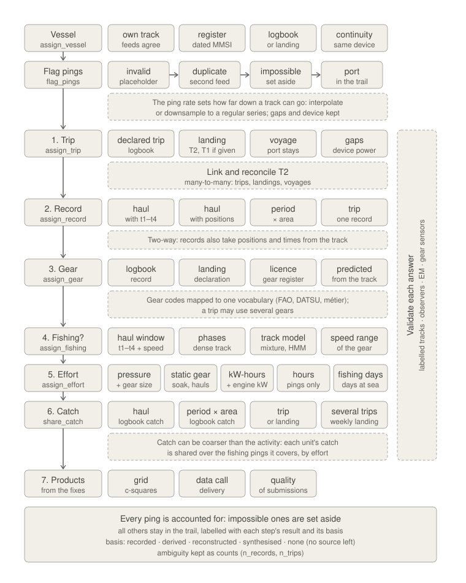
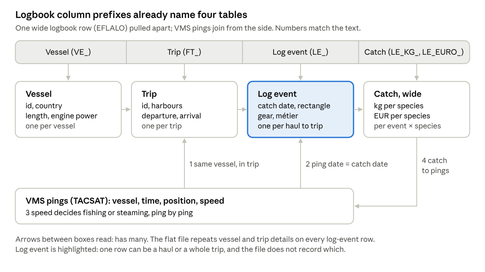
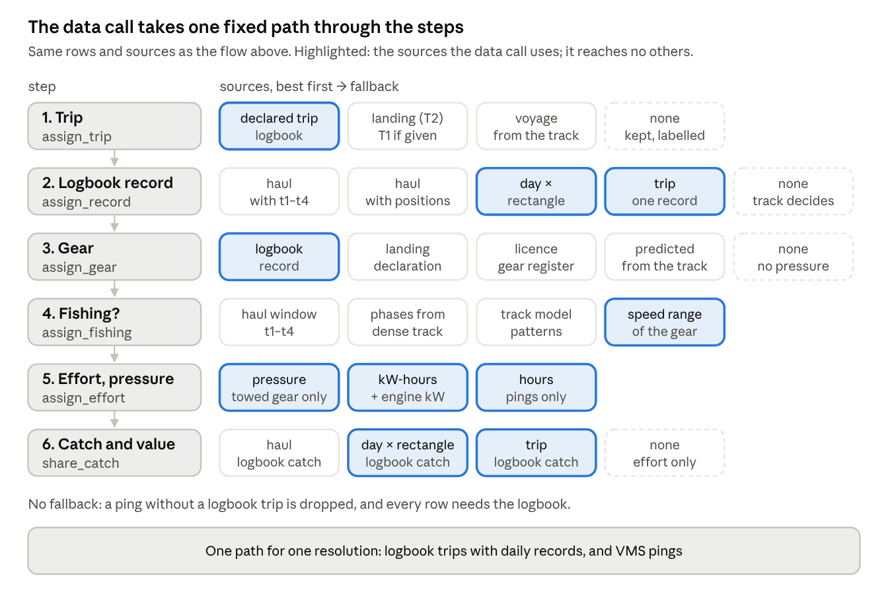

*The one home of this document. Version 1 was presented to WGSFD 2026 (claude.ai doc revision 108, 2026-10-07;
the group's copy is on SharePoint). Version 2 (2026-10-08) revised the diagram and the text it implies after the
meeting; on 2026-10-09 "harbour" became "port" throughout, and the section on fishycode was added (plan 014); on
2026-10-19 a stay became a port call and ramb's functions took their new names (decision 147), and fishycode's tables
their keys `port_call_id` and `voyage_id` (decision 149); later that day the diagram became version 3, amended from a
reading of seven ICES reports (decision 150). On 2026-10-24 the text was revised for the decisions of that week
(151-218): the link as the product and the split as the user's step (215), a trip's ends from ranked witnesses
(173, 174, 193), undecided as an outcome (200), the logbook's placeholder times (157, 158, 206), soak drift (198),
records typed by what they cover (214), flags that are never corrections (216, 217), and the checks as bookkeeping
(155, 199); the gagnakvörn opens it. On 2026-10-27 the status figure was redrawn on version 3's boxes, and "What
exists, and where" brought up to date, with what is decided and not built. It lived in `~/stasi/wgsfd2026` until
2026-10-19.*

*AI use: version 1 drafted by Claude (Anthropic) from the ICES VMS and logbook data-call code (commit `a844911`)
and the grammar of sea-going data. Version 2, the port terms, the fishycode section and the inventory ("What
exists, and where") drafted by Claude, 2026-10-08 and 2026-10-09, from the maintainer's comments, decisions
075-079 and a reading of the outside repositories (decision 078); the renames of 2026-10-19 by Claude, from the
maintainer's answers (decision 147); version 3 of the diagram and the text it implies by Claude, from the reading map
of seven ICES reports (`ices_reports.yml`, decision 150). The revision of 2026-10-24 by Claude, from the decision
records named above; the gagnakvörn's new labels, boat and sacks by Claude with the maintainer, who chose every label;
the drawing is Hammer's. The status figure and "What exists, and where" of 2026-10-27 by Claude, from ramb
2026.10.25.5's exports, the fishycode targets that call them, `TODO.md` and the decision records. Human review
pending.*

{fig-alt="A hand-drawn machine: a small fishing boat labelled STAKEHOLDER drops into a hopper, sacks labelled REGISTER, LOGBOOKS, LANDINGS and AIS fly in after it, and the data pass a ping flagger, a voyage chopper, a haul grinder, a candidate flattener, a link mixer and a filter into a patched barrel labelled CURATED, sent to ICES."}

Mapping fishing activity (effort, pressure on the seabed or stock, and catch) is one cascade, applied to every ping. First each ping gets its vessel, and pings no vessel could have made are set aside. Then:

1. find its trip;
2. find the logbook record that covers it, if any, and the phase of it;
3. find its gear;
4. judge whether the vessel was fishing: yes, no, or undecided, with why;
5. give every fix the time it stands for, and from it effort (hours, kW-hours) and a gear-specific pressure;
6. where a logbook or landings exist, split their catch and value over the fixes;
7. make the products from the fixes: grids, the data call's delivery, and checks of what was delivered.

**The main output is the link, not the split** (decision 215). Each fix carries the events it may belong to (the logbook record and its phase, the trip, the voyage and its port calls, the landing) and the evidence for each link: the window and its basis, and the fix's speed against the gear's range. Steps 4 to 6 are then a choice made over the linked fixes. A filter keeps some of them: the gear's speed range, the time window, both, or any other rule. The effort is the sum of the kept fixes' time, and the catch is split over them by the same time, as is any quantity the record adds up (value, hooks, nets, the logbook's own soak or tow hours). The flow's own filters are presets: references for the data call and the maps, and worked examples of the user's step.

**Effort and pressure need pings, the vessel register and the gear; only catch and value need a logbook or landings.** Each step takes the best source it has for each ping and falls back when it is missing, so one flow serves every data resolution. A later section reads the ICES VMS and logbook data call through this flow.

## The grammar, in brief

A set of linked tables, one per level and each child keyed to its parent, holds every vessel-based record at any resolution:

- **Trip** (`declared_trips`): departure to return (times `T1`, `T2`; ports).
- **Station** (`logbook_records`): one fishing operation, with where and when. Where is what the record holds: a point with its precision, a cell (a rectangle, a whole degree), or nothing.
- **Sample** (`logbook_records`): the act itself: gear and event times `t1`–`t4` (deployment starts, deployment ends, retrieval starts, retrieval ends).
- **Observation** (`logbook_catch`): catch by species, as the skipper records it in the logbook.
- **Ping stream** (`pings`; AIS, VMS) and **landings** (`landings`): parallel streams, linked to trips afterwards. Landings (sales notes) are recorded by a buyer or authority, not the skipper.
- **Resolution** on every logbook record: a haul, or a total over a day, week, month or trip. It is read from what the record's times and position cover, not from the table it sits in: a "station" whose times are the trip's departure and landing covers the trip, not an operation (decision 214).
- **Basis** on every derived value, its provenance: recorded, derived (computed from recorded values of the same record, e.g. `t2` + duration), reconstructed, synthesised, or none when no source has it. Modifiers, such as capped or rounded, and a precision (a half hour, a whole degree) go in columns of their own.

## The flow, step by step

Two preparatory steps, then six, in pipeline order, and the products made from the fixes. Each step takes, ping by ping, the best source it has, falls back when that is missing, and records which source answered. A band down the side marks validation: every answer is checked where something better is known.



### Vessel (`assign_vessel`)

Pings arrive with a transponder id (MMSI, or a national system's id), not a vessel. The same id can move between vessels, and a vessel can change id. The vessel comes from the best source:

- the vessel's own track, where another feed of the same vessel agrees;
- the vessel register's dated MMSI and call sign;
- the vessel's logbook or landings on the day;
- continuity of the same device before and after.

An id no source resolves keeps its pings, with vessel "none".

### Flag pings (`flag_pings`)

In order, each test only on pings not yet flagged:

- **invalid**: a placeholder position, e.g. 0, 0;
- **duplicate**: the same report from a second feed, seconds and metres apart; the higher-priority feed is kept;
- **impossible**: a position or jump no vessel can make.

These are set aside in their own table, not dropped: pings in equal pings out across the two tables. Pings inside a port polygon get its id (`port_id`) and stay in the trail.

**The ping rate sets how far down a track can go.** The groups return to it in almost every report: what the national VMS systems poll (WGSFD 2025a p. 3), a minimum rate for small vessels, around a ping every 30 seconds (WGSFD 2025b p. 14), and how the rate limits what can be classified and validated (WKSSFGEO 2022 pp. 24-25; WKSSFGEO2 2023 p. 2). A track can be interpolated to a regular series or downsampled to test how results change with the rate (WKSSFGEO 2022 p. 9; WGSFD 2025a p. 32). The device and its gaps are kept with the pings, since a silence is information too.

### 1. Trip (`assign_trip`)

- **Declared trip** (`declared_trips`, recorded): departure and return (`T1`, `T2`) from the logbook. Landings give the landing (`T2`), and in some datasets the departure (`T1`).
- **Voyage from the track** (reconstructed): from one port call to the next. A voyage is any such movement; a trip is a fishing trip, so voyages also include steaming between ports and other moves without fishing. A port call is time spent in a port, not a ping inside its polygon: one port ping followed by silence is not a port call, and the shortest port call can depend on the port. A silence near port is a port call when the time it leaves, after sailing from the last ping to the port and from the port to the next at the vessel's own steaming speed, is at least the shortest call: a time budget (decision 197). Where only `T2` is declared, the last port departure before it gives `T1`. Without a port list, as for many small-scale fleets, a port call can be read from a silence that begins or ends near the coast.
- **Gaps and device power** (reconstructed): where there is no port list, a long silence cuts the track (WGSFD 2025a p. 32; WKSSFGEO 2022 p. 47), and a tracker that logs its own power marks trip ends when it is switched off and on (WKSSFGEO2 2023 pp. 20-21).
- **None**: the ping is kept, labelled as having no trip. The aim is that no vessel is left without a trip.

**Link and reconcile** (not a fallback): logbook trips, landings and voyages are linked to each other, many-to-many. One trip can have several sales notes (one per buyer), one weekly landing can cover several trips, and one trip can span several voyages: a vessel in port overnight, or a net set on one voyage and hauled on the next.

Neither declared date is the time the vessel enters port. The logbook's `T2` is often the expected arrival, written before the trip ends: on the Icelandic e-logbooks, a median half hour from the track's, and more than an hour early on 15 % of trips (decision 174). The landing's date is the date the catch was declared or sold, which can be a day or more after arrival. So each end of a trip, its time and its port each on their own, is taken from ranked witnesses: the track first, then the logbook's own, then any other record that holds it (in Iceland the voyages of the national tracking system, the quota system's trip records and the calls in and out of port), and for the return the landing last. A date gives way to a time on its day. Every witness's value is kept beside the chosen one, with which witness answered and one outcome: none, one, agree (within an hour) or differ (decisions 173, 174). A trip whose operations lie in several voyages spans them all; where that span would reach another trip, the one linked voyage is kept, and flagged (decision 193).

This is the loop the design turns on: the declarations are needed to link trips to landings, but their dates are only trustworthy once the track has given the real departure and arrival. So the reconciled trip table, with departure and arrival from the witnesses and the logbook trips and landings linked to it, is an output of this step; it is not fed back to redo the declarations' own match.

### 2. Logbook record (`assign_record`)

Each ping gets the id of the logbook record whose period and area cover it (`record_id`, from `logbook_records`), and what that record covers (`resolution`). Records come at any resolution, read from what their times and position cover:

- a haul, with event times (`t1`–`t4`) or with positions;
- a total over a day, week or month, in a rectangle or area;
- a whole trip.

Several records may cover one ping, e.g. overlapping static-gear sets. Every candidate stays in a ping-to-record link with its evidence, and one record and one phase per ping is the default assignment beside them (one fix, one record; decisions 090, 215). With no record, the later steps rely on the track.

**A declared time is not always the skipper's.** Logbook apps fill required fields: a static-gear set 270 minutes before the haul, a tow's start copied from the trip's departure, a haul of under five minutes. Such a time is set aside and flagged, the original kept beside it, and the record falls back to its day: no window is made from a departure, landing or midnight stamp (decisions 157, 206, 214). The skipper's own rounding, to the hour or the half hour, is kept as written and labelled with its precision.

The flow also runs the other way: records take positions and times from the track, e.g. a haul's position from the pings inside its window. The reverse is not done: a logbook position is never merged into the track. Hauls meet pings by time, and the logbook's positions are judged against the track, not joined to it (decisions 156, 207).

### 3. Gear (`assign_gear`)

Gear, gear class (towed or static), width and quantity, from the best source:

- the logbook record;
- the landing declaration (`landings`);
- the licence (`gear_register`);
- predicted from the track by a model trained on vessels with known gear (`track_model`, synthesised).

With no gear, fishing is read from the track pattern alone, or left undecided, and pressure stays empty.

Whatever the source, the gear code is mapped to one vocabulary before it is used: FAO codes to the BENTHIS categories for pressure (WGSFD 2019 pp. 13-14; WGSFD 2022 pp. 15-16), and métier codes checked against the ICES lists (DATSU) before a delivery (WGSFD 2022 p. 3; WGSFD 2025a p. 28). A national métier can travel on the fixes as it is and be mapped to the ICES codes only when a delivery is made, so its finer classes are not lost on the way (decision 212). A trip may use several gears, common in small-scale fleets, so gear is a property of the operation more than of the vessel or the trip (WGSFD 2025a pp. 18-20; WGSFD 2025b p. 26; WKSSFGEO2 2023 p. 4).

### 4. Fishing? (`assign_fishing`)

Whether a fix was fishing is a filter over the linked fixes. The flow offers presets, and the user may choose another (decision 215). A preset puts every fix in one of three outcomes: fishing, not fishing, or undecided, with the reason.

- **Haul window and speed** (recorded). Every operation has four events: `t1` deployment starts, `t2` deployment ends, `t3` retrieval starts, `t4` retrieval ends. Towed gear fishes from gear on the bottom (`t2`) to gear off the bottom (`t3`), within the whole operation (`t1`–`t4`); static gear is visited while setting (`t1`–`t2`) and hauling (`t3`–`t4`). Within the window, a ping counts as fishing when its speed is in the gear's fishing range (`gear_speeds`). The median speed of the pings within ±10 minutes is steadier than a ping's own and fits recorded tows better (fishycode decision 090).
- **Partial times** (derived or synthesised): any subset may be reported, e.g. a trawl haul with only `t1` and `t4`. The window is the reported span, narrowed by typical durations (`gear_rules`), or the whole day when no time is given. A time set aside as an app's placeholder counts as not given.
- **Coarser record, or none**: the track decides, within the record's period and area if there is one.
- **Undecided** is an outcome, not a gap: a fishing vessel's voyage with no record and no gear is undecided ("no record"), not "not fishing", until its gear can be read from the track (decision 200; in Iceland 50,329 of the 509,230 voyages of fishing vessels since 2017).

Reading the track (reconstructed):

- simplest: the gear's fishing speed range (`gear_speeds`);
- better: patterns over consecutive pings, such as speed steadiness, turning and how long a state lasts (`track_model`, e.g. mixture models or hidden Markov models);
- with frequent pings, the operation's phases (deployment, towing or soak, retrieval): `t1`–`t4` reconstructed from the track. For static gear the set can be sought from the haul, as the earlier pass along the same line; the set and the haul can fall on different voyages (the gear soaks while the vessel is in port), so pairing them also links the voyage that set the gear to the voyage that retrieved it. It is harder than it looks: on 152,880 Icelandic static hauls with a real set time, the track's set finder came within an hour of it on 54 % of longlines, 32 % of gillnets and 4 % of pots, worse for longlines and pots than assuming the vessel's typical soak (decision 158). There, a set's time is the logbook's or none;
- haul windows from well-recorded vessels train and test these methods.

**The soak is not the vessel's fishing.** While static gear soaks, it fishes where it was set, not where the vessel drifts. Slow drift before a haul is not fishing on the vessel's fixes unless the stretch looks like hauling, and a static gear's effort belongs on its set line, as soak × gear (decision 198).

No fix is removed by this step: not fishing and undecided are labels.

**Validation** (the band down the side of the diagram) is where the groups have spent much of their effort. Each answer is checked against something better where it exists: expert-labelled tracks, logbook hauls with times, observers and electronic monitoring, and gear sensors such as hauler counters (WKSSFGEO 2022 pp. 22-25; WKSSFGEO2 2023 pp. 1, 16, 23-24; WGSFD 2025a p. 50). The checks give measured error, such as the share of pings misclassified by speed, by method and by ping rate (WGSFD 2025b pp. 27-29). That error, measured on the well-recorded part of the data, is what lets the rest be trusted.

A check is bookkeeping before it is a statistic. Every record and every kilogram is placed in one outcome, the unjudgeable included, and an agreement rate is never a pass however high: a 99.5 % agreement between a fix's trip by its station and by its voyage was counted over the fixes that had both, and 13.8 million fixes never reached the comparison (decision 155). fishycode's allocation audit has since tested every link the flow makes against the records' own times (decisions 155, 199).

### 5. Effort and pressure (`assign_effort`)

Every fix carries its time, the interval it stands for, fishing or not. The effort of an event is the sum of that time over the fixes the filter keeps, and the same time is the catch split's key, so effort and catch come from one choice (decision 215):

- **hours**: the interval to the next ping, long gaps capped;
- **kW-hours**: hours × engine power (`vessel_register`);
- **pressure**, gear-specific: swept area for towed gear (width × speed × time); gear quantity × soak time for static gear, where set and haul can be placed.

No logbook or landings are needed. Without engine power, hours only; without width or quantity, no pressure.

Two more measures the groups use:

- **static gear**: the track shows the vessel, not the gear, so a classifier measures vessel effort. Gear effort for nets and pots is soak time, net length hauled, or the number of sets and hauls (WKSSFGEO 2022 pp. 15, 28-29; WKSSFGEO2 2023 pp. 5, 26);
- **fishing days**: the official unit, a calendar day at sea with fishing. It is recorded differently by source (logbooks, sales notes, sampling) and by vessel length, so days from tracks, logbooks and the EU's fishing-effort statistics (FDI) do not agree (WKSSFGEO 2022 pp. 12-13, 27-28; WKSSFGEO2 2023 pp. 56-57).

### 6. Catch and value (`share_catch`)

Needs logbook catch (`logbook_catch`) or landings (`landings`). A unit's catch is split over the fixes the filter keeps, by their time, and value follows the catch. So does any quantity the record adds up (hooks, nets, the logbook's own soak or tow hours), its parts summing to the record's total. A label (gear, métier, port) and a value that does not add up (a price, a mesh size) is inherited, not split (decision 215; [the grammar](grammar.qmd), "Moving a value between units").

Catch can be coarser than the activity: fishing may be known per haul while catch comes per day and rectangle, or as a weekly landing that covers several daily trips. Each unit's catch is shared over the fishing pings it covers, whatever its resolution.

| Unit | Source | A fishing ping shares when |
| --- | --- | --- |
| haul with times | logbook | it is inside the haul's window |
| haul with positions | logbook | it is on the haul's day, near its track |
| day × rectangle | logbook | date and rectangle agree |
| week or month × area | logbook | it falls in the period and the area |
| trip | logbook or landings | it is in the trip |
| several trips | landings, e.g. weekly | it is in one of those trips |

- **Kilograms in equal kilograms out, whatever the filter.** A unit left with no kept fix moves up to the next unit that overlaps it, then to the vessel's month; what still finds no fix is kept with no time and basis "none".
- **Catch a landing contradicts is flagged, never corrected.** A trip's logged catch of a species more than ten times what its landings hold of it, and a tonne more, or above the largest landing of its species or of its vessel where no landing is linked, is marked and stays on the fixes, so the user's filter can keep it or leave it out (in fishycode `kg_flagged`; 316 kt flagged, decisions 216-218).
- **Catch landed by another vessel is not raised onto the fixes.** A pelagic transfer trip can land up to 300 times what it logged; its logged catch goes on its fixes, and the excess landed weight to an outcome of its own (decision 199).
- With neither source, effort and pressure are mapped; catch and value are "none".

### 7. Products (from the fixes)

The fixes are the product; what most users see is made from them:

- **a grid**: effort, pressure and catch summed into cells, c-squares in the ICES data call, finer where the data allow (WGSFD 2022 p. 11; WGSFD 2025a p. 8);
- **the data call's delivery**: the national tables, built by the ICES workflow in three blocks (WGSFD 2025a p. 11);
- **checks of what was delivered**: the format screened against the ICES code lists, and a quality report that submitters see before ICES uses the data (WGSFD 2019 p. 2; WGSFD 2022 p. 1).

A product is a filter and a sum over the linked fixes. Because every fix keeps its links, labels and basis, a product can be rebuilt at another grid, period, filter or definition without redoing the flow.

## How far down each kind of data gets

Every row runs the same steps and goes as far as its data allows. Effort and pressure are the same in every row, given pings, the vessel register and the gear. The rows are not separate datasets: one dataset mixes them by vessel, fleet, year or trip, and each ping takes its own path.

| Data available | Trip | Logbook record | Fishing | Catch and value |
| --- | --- | --- | --- | --- |
| Pings and registers only | voyage from the track: `T1`, `T2` from the port calls | with dense pings, operations from the track: `t1`–`t4` reconstructed (set and haul paired for static gear, where the track can tell) | track, or undecided | — |
| + landings | landing; `T1` if given, else the track | — | track | over the trip, or the trips a landing covers |
| + weekly or monthly logbook | logbook, else track | period × area | track, within the period | per period × area |
| + daily logbook | logbook | day × rectangle | track, within the day | per day × rectangle |
| + hauls with positions | logbook | haul | track, near the haul | per haul, approximate |
| + hauls with times | logbook | haul window | haul window and speed; track as a check | per haul |

Ping density varies in the same way, within one dataset:

- dense AIS (seconds to minutes) supports `t1`–`t4` reconstructed from the track;
- sparse VMS (an hour or more) supports only speed or pattern rules, with wider uncertainty in effort, and can miss operations shorter than the ping interval.

## One flow, every ping accounted for

- One process for every resolution, of logbooks and pings alike: each step takes the finest evidence available for that ping and records which it was (its provenance), so a dataset that mixes resolutions needs no special handling.
- The same output at every resolution: no step stops because a table is missing. With no trip or station table, `T1` and `T2` come from the port calls and `t1`–`t4` from the track itself; with declarations, they come from those and the track checks them. The columns are the same either way; what fills them, and the basis that says so, depends on the data.
- Declarations are evidence, not truth. A declared time (`T1`, `T2`, `t1`–`t4`) is kept, refined or overridden by the track, depending on how precisely the track places that moment: dense pings may overwrite it, sparse pings may not. The declared value is always kept beside the chosen one, with the case and its provenance. Where two sources contradict each other, the contradiction is flagged, never corrected.
- Fixes are linked and labelled, not filtered: each keeps the events it may belong to, its gear, its time, and under each preset fishing, not fishing or undecided, each with its basis and flags.
- Only invalid, duplicate and impossible pings are set aside, in their own table; port pings stay, labelled.
- What counts is chosen by the user's filter, so every total traces back: pings in equal pings out, kilograms in equal kilograms out, and every record of the sources has a fate (in fishycode, every station and trip of the logbooks, kept or not, with why; decisions 194, 205).

## The flow as code

A sketch, not a package. The steps are those above, in order; each takes the pings plus the tables in its brackets, adds its labels with a basis, and passes every ping on.

```r
pings |>                              # transponder id, time, lon, lat, speed (AIS, VMS)
  assign_vessel(vessel_key) |>        # transponder id -> vessel, dated: own track, register, logbook, continuity
  flag_pings(ports) |>                # invalid, duplicate, impossible: flagged, then set aside;
                                      #   port polygons: in-port pings labelled, kept
  assign_trip(declared_trips) |>      # vessel, T1, T2: logbook or landings; landings may lack T1 (optional);
                                      #   missing T1, or whole voyages, from the track, port call to port call;
                                      #   each end from ranked witnesses, the track first
  assign_record(logbook_records) |>   # vessel, period, area, gear, resolution (optional):
                                      #   a haul with t1–t4, or a day, week, month or trip; every candidate kept
  assign_gear(landings,               # gear declared on the landing (optional)
              gear_register,          # vessel, year, gear, width, quantity: licence (optional)
              track_model) |>         # predicts the gear from the track pattern (optional);
                                      #   the logbook record's gear comes first
  assign_fishing(gear_rules,          # presets: haul window per gear class, typical durations
                 gear_speeds,         # fishing speed range per gear class
                 track_model) |>      # pattern or phase model, trained on recorded windows (optional);
                                      #   fishing TRUE, FALSE or NA (undecided), with a reason
  assign_effort(vessel_register) |>   # vessel, year, kW, length: the time of every fix, fishing or not
  share_catch(logbook_catch,          # logbook record, species, kg: the skipper (optional)
              landings,               # trip or trips, species, kg, value: buyer or authority (optional)
              filter = fishing,       # the user's: any logical column; the presets are examples
              key = hours)            # split by each kept fix's time
```

**Inside each step.** The steps are passed tables, but what they use are the variables inside them: each variable is taken, ping by ping, from the best table that has it (`>` reads "else").

```r
assign_vessel(pings, vessel_key)
  # needs:   transponder id, time
  # sources: own track (another feed agrees) > register (dated MMSI, call sign) > logbook or landings > continuity
  # adds:    vessel, vessel_basis

flag_pings(pings, ports)
  # needs:   vessel, time, lon, lat, speed
  # rule:    in order, each on pings not yet flagged: invalid > duplicate (second feed) > impossible;
  #          port = inside a port polygon
  # adds:    flag, port_id   (flagged pings are then set aside in their own table)

assign_trip(pings, declared_trips)
  # needs:   departure (T1), arrival (T2)
  # sources: track: port call to port call > logbook > other records > landings (T2 only)
  # rule:    same vessel, T1 <= time <= T2; trips, landings and voyages linked many-to-many;
  #          each end, time and port apart, from the best witness holding it, every witness kept
  # adds:    trip_id, trip_basis, and per end its witness and outcome

assign_record(pings, logbook_records)
  # needs:   record_id, period_start, period_end, area, resolution
  # sources: logbook records, at any resolution; app placeholders set aside
  # rule:    same vessel, time in the period; every candidate linked, one record and phase the default
  # adds:    record_id, phase, resolution, n_records

assign_gear(pings, landings, gear_register, track_model)
  # needs:   gear, gear_class, width, quantity
  # sources: logbook record > landing > licence > predicted from the track
  # adds:    gear, gear_class, width, quantity, gear_basis

assign_fishing(pings, gear_rules, gear_speeds, track_model)
  # needs:   gear_class; t1-t4, or track features, or a speed range
  # sources: haul window and speed > phases from a dense track > track_model > gear_speeds
  # adds:    fishing (TRUE, FALSE, NA), fishing_reason, fishing_basis

assign_effort(pings, vessel_register)
  # needs:   interval, kw, width or quantity
  # rule:    every fix; hours = interval to the next ping, long gaps capped;
  #          kw_hours = hours x kw; pressure = swept area (towed) or quantity x soak (static);
  #          an event's effort = the sum over the fixes the filter keeps
  # adds:    hours, kw_hours, pressure, pressure_unit, effort_basis

share_catch(pings, logbook_catch, landings, filter, key)
  # needs:   kg, value, and the record, trip or trips they belong to
  # sources: logbook catch (haul > period > trip) > landings (trip > several trips)
  # rule:    fix share = unit kg (and every additive column) x fix key / the key of the unit's kept fixes;
  #          a unit with no kept fix moves up a level, then to the vessel's month: kg in = kg out
  # adds:    kg, value, kg_flagged, catch_basis

# result: one row per kept ping, every column present, each with its basis;
#         set-aside pings in their own table, with their flag
```

What the added variables mean:

| Variable | Meaning |
| --- | --- |
| `vessel` | the vessel the ping belongs to, from its transponder id and the date |
| `flag` | why a ping was set aside: invalid, duplicate or impossible; empty for kept pings |
| `port_id` | the port the ping lies in; empty at sea |
| `trip_id` | the trip the ping belongs to, declared or rebuilt from the track |
| `record_id` | id of the logbook record the ping is assigned to; every candidate is in the ping-to-record link |
| `phase` | deployment, towing, soak or retrieval, where the record or track can tell |
| `resolution` | what that record covers: haul, day, week, month or trip |
| `n_records` | how many logbook records cover the ping; above 1 means overlap |
| `gear`, `gear_class` | the gear code; towed or static |
| `width`, `quantity` | gear width (towed); number of hooks, nets or pots (static) |
| `fishing` | TRUE if the preset judges the ping fishing, FALSE if not, NA if undecided |
| `fishing_reason` | why, where it is not plain: e.g. "no record" for an undecided voyage |
| `hours`, `kw_hours` | the time the ping stands for, on every ping; the same times engine power |
| `pressure`, `pressure_unit` | gear-specific pressure and its unit, e.g. km² swept or hook-hours |
| `kg`, `value` | the ping's share of the catch and of its value, under the filter |
| `kg_flagged` | the part of `kg` that a contradiction between the sources flags |
| `*_basis` | where each value came from: recorded, derived, reconstructed, synthesised or none |

A step halts per ping, not per run. Where no source supplies a variable, the ping gets `NA` with basis "none", and the flow goes on:

```r
share_catch <- function(pings, logbook_catch = NULL, landings = NULL, filter = fishing, key = hours) {
  units <- catch_units(logbook_catch, landings)   # finest unit with catch per ping; empty if no source
  pings |>
    left_join(units, by = "ping") |>              # pings with no unit get NA, not an error
    group_by(unit_id) |>
    mutate(kept        = {{ filter }} %in% TRUE,  # undecided is not kept
           share       = if_else(kept, {{ key }} / sum({{ key }}[kept]), 0),
           kg          = unit_kg * share,
           value       = unit_value * share,
           catch_basis = if_else(is.na(unit_kg), "none", unit_basis)) |>
    ungroup()
}
```

- With pings and the vessel register only, the run ends with voyages and fishing from the track, and with hours and kW-hours. Every kept ping has every column, and the missing ones say "none".
- A step that needs an earlier label skips pings without it in the same way: no trip, no catch share.
- A mixed dataset runs through the same code; its pings just carry different bases.

## The ICES data call, seen through this flow

The ICES VMS and logbook data call runs the same six steps, but along one fixed path built for one resolution: daily logbook records with VMS pings. It has no fallback, and keeps only what reaches its two tables.

**Its inputs.** The logbook file (EFLALO) packs vessel, trip, log event and catch into one row; the VMS file (TACSAT) is the ping stream.



Pings attach to the trip by time and to the log event by date, then receive the catch. Read through the grammar, the file shows three things:

- **Repetition is the format.** Vessel and trip details repeat on every row; the layers must be rebuilt before use.
- **The catch columns are landings, not catch.** Usually sales-note landings allocated down to log events, with nothing in the file saying so.
- **A log event has no stated resolution.** A row can be a haul, a day in a rectangle or a whole trip, and the file does not say which.



| Step | What the data call does | What it cannot do |
| --- | --- | --- |
| Flag pings | drops pings outside ICES areas, exact duplicates, pings under 5 min apart, positions out of range, and pings within a fixed buffer of a harbour point | keep port pings, labelled; read time in port (port calls) rather than points; set impossible pings aside with a reason |
| 1. Trip | brackets each ping by the logbook trip's departure and landing | rebuild trips from the track; keep pings outside a logbook trip; keep a trip that crosses New Year |
| 2. Logbook record | takes the log event whose catch date is the ping's date | use haul times or positions; handle weekly or monthly records; say what resolution a record has |
| 3. Gear | takes the gear of that log event, or the trip's main gear | take gear from landings, licences or the track |
| 4. Fishing? | judges each ping by its own speed: a Gaussian mixture with fixed peaks per towed metier, or a set range (1–6 kn) for other gears | use haul windows; read track patterns or phases; resolve operations shorter than the ping interval; say "undecided" |
| 5. Effort and pressure | interval since the previous ping, kW-hours, swept area from a gear-width model, per 0.05° c-square | give effort without a logbook; give a pressure metric for static gear |
| 6. Catch and value | shares logbook catch and value by effort: day × rectangle, then trip, then vessel and year | share below day level; place the catch of a multi-day trip reported as one record |

Across the flow:

- **One resolution.** Haul-level logbooks are used at daily level; trip-level records run, but the date on the record decides where the catch goes; pings alone give nothing.
- **Filtering, not labelling.** Pings that are not fishing, and records that fail a check, leave no trace, so outputs cannot be traced back to inputs.
- **No basis.** Nothing records whether a value was recorded, reconstructed or synthesised.
- **No disclosure step.** The output lists the vessels in each cell; ICES applies the 3-vessel rule after submission.
- **Lost in aggregation.** What the fixed path cannot carry is dropped on the way: the haul, anything finer than 0.05°, the pings in port, a national métier finer than the ICES codes. They are the barrels in the gagnakvörn at the top of this chapter. A delivery made from the linked fixes is one filter and one sum over them, and loses nothing it does not choose to (decisions 202, 215).

*Checked again on 2026-10-09: the repository's head is still `a844911`, the commit read above. Since early 2026 the seines' swept area uses sfdSAR's seine formulas, and pings whose gear disagrees with the metier are dropped.*


## How fishycode runs this flow

fishycode puts one line between Icelandic **preprocessing** and the **generic flow** (plan 014, decision 075).
Preprocessing reads no AIS; it turns each source into a standard input, and may reconcile the logbook with the
landings. Four **one-time fixes** sit outside both: built once, reviewed, and read by the build as frozen
inputs (`_targets_once.R`). The flow runs ramb's `rb_` functions, one per step. Every script names its side in a
`# Side:` header. Oracle's tables are read, never its views, and the conversions the views made are done in R.

| Layer | What | Where |
|---|---|---|
| Preprocessing | adapters per source; logbook merge, with the fate of every station and trip; landings merge; the AIS feed union; the logbook ↔ landings match, every landing read; gear from the landing, compared as a metier label (gear_target2, e.g. OTB_NEP); the other witnesses of a trip's departure and return (STK's voyages, the quota system's trips, the calls to port); catch the landings contradict, flagged | `sources/`, `reference/`, `curate/{logbook,landing,ais_ping_union,link_lid_map}.R`, `curate/corrections/` |
| Standard inputs | pings (with `pos_basis`), ports and their departure radius, STK port events and voyages, declared trips, records, landings and their link, each record's gear, the quota system's trips and the calls to port, the catch flags | `staging/ais/ping_union`, `staging/aux/ports.fgb`, `staging/ais/stk_event.parquet`, `staging/stk/voyage.parquet`, `staging/quota_trip/`, `staging/phone_call/`, `curated/logbook/` (with `catch_flag`, `station_fate`, `trip_fate`), `curated/landing/` |
| One-time fixes (frozen) | the STK mobile-id → vessel key; the GPS logger positions (interpolated once from AIS); the port departure radius, to be retired for the time budget (decision 197); the register's history to 2023-12-19 (decision 132) | `curated/vessel/vessel_ais_key.parquet`, `curated/logbook/sensor_gps/`, `curated/reference/port_radius.parquet`, `curated/vessel/skipaskra/` |
| Flow | the steps below | `curate/`, ramb |

| Step | fishycode | ramb | Output |
|---|---|---|---|
| Vessel | the frozen key (STK); vessel identity by MMSI and date (commercial feeds), in the union | (`rb_add_vessel`, planned) | `staging/ais/ping_union` |
| Flag pings | `ais_ping_tag.R`, `ais_ping_clean.R`; only recorded positions are tested for duplicates and impossible jumps | `rb_flag_ping_port`, `rb_flag_ping_invalid`, `rb_flag_ping_duplicate`, `rb_flag_ping_impossible` | `staging/ais/ping_clean`, set aside: `ping_whacky` |
| 1. Trip | `port_call.R` (one 2 h minimum in port), `ais_voyage.R`, `link_trip_voyage.R`, `trip_reconciled.R`: each end from ranked witnesses (AIS, the logbook's own, STK, the quota system, the phones), across every voyage the trip's stations lie in (decisions 173, 174, 193) | `rb_create_port_calls`, `rb_create_voyages`, `rb_add_voyages`, `rb_link_trip_voyages`, `rb_add_trip_time` | `curated/ais/{port_call,voyage}.parquet`, `curated/ais/ping`, `curated/link/{trip_voyage,trip_reconciled}.parquet` |
| 2. Record | `station_window.R`, `ais_trail.R`; the placeholder set times set aside (decision 158) | `rb_limit_record_duration`, `rb_create_record_windows`, `rb_link_record_pings`, `rb_add_record` | `curated/logbook/station_window.parquet`, `curated/ais/trail`, `trail_match` |
| 3. Gear | preprocessing: `curate/corrections/logbook_gear.R`; flow: `voyage_gear.R`, the voyage's gear from the logbook stations whose own times lie in it, else its landing (decisions 101, 154 and 155) | — | `curated/logbook/gear.parquet` (`gid`, `gid_landing`, `metier`), `curated/ais/voyage_gear.parquet` |
| 4. Fishing | `ais_trail.R`: the window and the ±10 min speed (`fishing`); the window, else the voyage gear's speed range (`fishing_flow`, decision 101). The two presets of decision 215 | `rb_add_fishing(method = "window")`, `rb_add_fishing(method = c("window", "speed"))` | `curated/ais/trail` (`fishing`, `fishing_flow`, `fishing_flow_basis`) |
| 5–6. Effort, catch | `ais_trail.R`: the time of every fix; `ais_catch.R`: catch per fishing fix, unit, species and preset, with the landings linked to their voyages, a raising factor and the flagged part (decisions 101, 102, 216, 217) | `rb_add_effort`, `rb_add_catch_units`, `rb_share_catch` (its `fishing` argument takes any logical column), `rb_link_trip_landings` | `curated/ais/trail` (`hours`, `kw_hours`), `curated/ais/catch` (`kg`, `kg_flagged`) |
| Checks | `curate/checks/allocation_audit.R`: every link the flow makes against the records' own times, every record in one outcome (decisions 155, 199) | — | `curated/check/allocation_audit.parquet` |

A ping carries keys, not the values of its port call or voyage; those live once, in their own tables (the trail repeats a few voyage values on each fix, decision 147). The record
gives each fix its gear as `metier`: Iceland's own, from which the ICES codes are mapped when a data call is answered (decision 212).

Every target was rebuilt from raw on 2026-10-23, at 916b901 with ramb 2026.10.22.2 (decision 218). What was decided
that week and waits for the next build is listed under [Decided, not built](#decided-not-built).

## What exists, and where (2026-10-27) {#what-exists}

![Who has each piece, as of 2026-10-27, on version 3's boxes. A box takes the colour of its most advanced home: built in ramb (or in fishymodel, its sibling for track models), built in fishycode only (Icelandic preprocessing, a one-time fix or a flow script), planned, coded or decided but not built, found only elsewhere (the ICES data call, WKSSFGEO, WKSSFGEO2, iapesca, others), or nowhere. A dot marks a piece fishycode's build fills on its data. The column on the right is what is decided and waits for the next build.](figures/one_flow_status.svg)

The data on disk are the rebuild of 2026-10-23 (decision 218), and nothing in the flow's code has changed since: the
days after went into the products, the place names and the reading of outside work. "Planned" means written down in
fishycode plan 013 or plan 031 and not built; "coded" that the code is committed and not built (plan 029); "decided"
that a decision record chose it and nothing builds it yet. Outside code was read on 2026-10-09 (decision 078), on
2026-10-19 (decision 148), and on 2026-10-26 and 27 (EM4SSF's deliverables and Peskas, decisions 229 and 231). ramb has
three pieces recoded from it:
- CNR-IRBIM's trip finder (`cnr`);
- Ifremer's trip finder (`iapesca`);
- iapesca's set ↔ haul pairing (`rb_link_record_sets`).

Each was checked against the published code. Nothing outside ramb is copied into it. The workshops' example data are
on [their own page](wkssfgeo.qmd).

| Step | ramb | fishycode | ICES data call (`a844911`, vmstools, sfdSAR) | WKSSFGEO, WKSSFGEO2, iapesca, others |
|---|---|---|---|---|
| Vessel | built: `rb_link_vessel_tracks` (two feeds matched by co-location, decision 146), `rb_classify_mmsi`. Planned: `rb_add_vessel` (the time-bounded join) | built and frozen: the STK mobile-id → vessel key, from the register, the vessel's own track, logbook and landings, continuity (plans 003, 009); the commercial feeds by MMSI and date, in the union. Ready and not run: the key's redo (decisions 195, 204; TODO 25) and the first allocation of vids, one per hull (decision 190, TODO 65). A ping with no vid is still dropped before the voyages, so foreign hulls do not reach them; 107 Icelandic vids land fish and are never heard (TODO 24) | assumes VMS and logbook share one vessel id | — |
| Flag pings | built: `rb_flag_ping_invalid`, `_duplicate`, `_impossible`, `_port`; they label, never drop. Interpolation is linear only (`rb_interpolate_track`) | calls them; only recorded positions are tested; exact time ties flagged. Open: interpolated positions are not tested against recorded ones (TODO 99) | drops pings (see above) rather than labelling them | iapesca's speed filter (55–60× slower than ramb's); its fast-run idea is in TODO 88 |
| 1. Trip | built: `rb_create_port_calls` and `rb_create_voyages`, sharing their methods (`dwell`, `runs`, `jepol`, `cnr`, `iapesca`); `rb_add_voyages`, `rb_link_trip_voyages`, `rb_link_trip_landings` (decision 102), and the departure and return (`T1`, `pid1`, `T2`, `pid2`) from ranked witnesses, the track first (`rb_add_trip_time`, decisions 173, 174). Gaps cut a trip only inside `cnr` (a silence of 4 h) and `jepol`. Planned: the declared-trip tier; port calls by a time budget, and records as evidence for them (`rb_create_port_calls(records = )`, decision 197) | the logbook ↔ landings match (`lid_map`), every landing read since the 2007 bound was lifted (decisions 203, 205); one 2 h minimum port call, with the frozen departure radius; STK port events; `trip_reconciled`, each end from ranked witnesses across every voyage the trip's stations lie in (decisions 173, 174, 193). Decided, not built: port calls by the time budget (decision 197). Open: the voyage definition (plan 031, TODO 90), the voyages that still hold several trips (TODO 147), and ties that depend on the run (TODO 139) | trips only from the logbook; pings tied by time; unmatched pings and trips over New Year dropped | not in ramb: trips without a port list (the Irish gap rule, iapesca's coastline mode, the power-on rule of CNR-IRBIM's trackers); mooring sites learned from the track (Mendo et al. 2024; GFW's `pipe-anchorages`); CNR-IRBIM's coastal zones, which its join rule needs. ramb's default projection for port buffers is right only at high latitudes |
| 2. Record | built: `rb_create_record_windows` (tow, set, haul, jig, day), `rb_create_record_pings` (records with no pings), `rb_link_record_pings`, `rb_add_record`, `rb_limit_record_duration`, `rb_link_record_events` (the fix that bounds each declared time), `rb_create_record_stretches` and `rb_link_record_stretches` (the track's towing stretches paired with the declared tows, in order and one to one), `rb_link_record_sets` (the set of each static-gear haul, decisions 103 and 146; on Icelandic static gear it does not recover the real set times, decision 158). Planned: declared `t1`–`t4` reconciled with the track. Not built: windows from haul positions; trip-level records | station windows, every candidate in `trail_match`, and the fix that bounds each declared time (`link_station_event.R`); the placeholder set times set aside (decisions 157, 158); the fate of every staging station and trip (decisions 194, 205); the spring survey's tows against the track's towing stretches, as a check (`survey_tow_times.R`, decision 104). Decided, not built: a record typed by what its times and position cover (decision 214), the logbook apps' dummy times (206), haul ends by kind (207). Open: day windows past midnight (TODO 105), windows that hold steaming or a jump (TODO 142), what a towed `t3` is (TODO 146) | the log event of the ping's date, else the record with the most catch; a haul-time match exists but is switched off | a second set finder, by buffer and overlap (Mendo et al. 2023) |
| 3. Gear | built: `rb_predict_gear_width` (BENTHIS), `rb_fill_gear_width`, `rb_extract_metier`, `rb_get_gear_vocabulary` (ICES's code lists). Planned, on hold: `rb_add_gear` | the landing's gear where it names one metier, the logbook's kept beside it (`gid_used`); the voyage's gear from its stations, else its landing (`voyage_gear.R`, decisions 101, 154, 155); Iceland's own `metier` on the trail. Decided, not built: a deterministic voyage gear (decision 199, TODO 139) and the métier mapped to ICES's codes at delivery (decision 212). Coded, not built: the licence history (plan 029, TODO 84). Parked: métier 6 and the legal mesh (TODO 131, 133) | the logbook's metier, checked against the ICES lists; widths from the user, then BENTHIS, then a default | gear from the track: CNR-IRBIM's Adriatic random forest, gear from hauls (Lattanzi et al. 2026), GFW's `vessel-classification` |
| 4. Fishing | built: `rb_add_fishing(method = "window")`, `"speed"` and the window-then-speed cascade (decision 101), on a fix's own speed or the median over ±`window_s` (`rb_calc_speed_smooth`). The track models (Gaussian mixture, EMbC, HMM) are in the sibling package fishymodel, benched in decision 103. Planned: those models as methods (`"gmm"`, `"embc"`, `"hmm"`), and `rb_build_fishing_speeds` | the two presets of decision 215 on the trail: `fishing`, the window × the gear's speed range on the ±10 min median speed (decision 093), and `fishing_flow`, the window, else the voyage gear's range. Decided, not built: a fishing vessel's voyage with no record undecided (decision 200; 50,329 of 509,230 voyages since 2017, today not fishing with no reason) and soak drift not fishing (decision 198). Open: the gear read from the track (TODO 86), which the undecided voyages wait for | a Gaussian mixture per towed metier; a set speed range for other gears | movement features and random forests (iapesca; CNR-IRBIM's SoftwareX code, Python); HMM practice (Irish Marine Institute) |
| 5. Effort | built: `rb_add_effort` (hours, kW-hours, swept area; decision 099), step times, gear widths. Pressure is for towed gear only; static gear's quantity × soak is planned (plan 013, item 8) | `hours` and `kw_hours` on every fix of the trail, fishing or not (decisions 101, 215). Not on the trail: swept area, static-gear pressure, fishing days. Under `fishing`, intervals over 1 h are 0.17 % of fixes and 3.1 % of hours (decision 231) | interval within the trip, kW-hours, swept area (sfdSAR), 0.05° c-squares, habitat and depth | static-gear effort as net length × soak time; hours apportioned by track length per cell |
| 6. Catch | built: `rb_add_catch_units` and `rb_share_catch`: units at any resolution, split under any logical filter, up a level, kg in = kg out (decisions 100, 102); the EFLALO sharing as `method = "eflalo"`. Planned: any additive column split, not only kg and one value; catch over several trips (a weekly landing); the name `rb_split_catch` (decision 215, TODO 127, parked) | `curated/ais/catch`: per fishing fix, unit, species and preset, with `raise_factor` (decision 102) and `kg_flagged`, 316 kt flagged (decisions 216-218). Decided, not built: every logged kilogram in a catch unit and one outcome, in every year (plan 038 §7.1, decision 191), and a transfer trip's excess landed weight in an outcome of its own (decision 199). 54 % of the logbook's kilograms are logged before 2007 and are in no unit. The landings flow (plan 039) is not built | `splitAmongPings`: day, then rectangle, then trip, weighted by interval | — |
| 7. Products | built: `rb_bin_midpoint` (any cell size), `rb_encode_ices_rectangle`, and the map viewer, `rb_map()` with its layers, groups and tiles (plan 046). Not built: c-square codes; a check of a delivery | the user tables, version 0 (`$FISHYDATA/products/v0/`, decision 219); the effort map, a grid whose cell follows the zoom, the fixes as recorded or spread along the track (decisions 220, 227, 228), and one voyage's map (decision 227), both on ramb's viewer. `products/ices_vms_datacall/` is the 2025 delivery's script and does not run on the curated trail; it is to read the curated catch and kW (decision 202, plan 015, TODO 27b). Not built: a versioned release (TODO 140), the flow on one vessel (plan 047) | 0.05° c-squares; the delivery screened by DATSU, then a quality report (WGSFD 2022 p. 1; WGSFD 2025a p. 28) | finer grids (0.01°, 100–1000 m; G1 p. 40, G2 p. 70) |
| Validation | nothing as a function: the audit as a generic tool is parked (TODO 101), and no score (accuracy, kappa, F-score) is computed | the allocation audit, every link against the records' own times, every record in one outcome (decisions 155, 199); the fate of every station and trip (decision 194); catch the landings contradict, flagged (decisions 216, 217); the STK key's audit (`once`). Two paths' error measured on the well-recorded part of the data: the track's tow boundaries against the spring survey's tows (decision 104), and the set finder against real set times (decision 158); the others not | — | expert-labelled tracks, observers, electronic monitoring, gear sensors (WKSSFGEO 2022 pp. 22-25); scores in the wish list below |

**Nowhere yet:** record windows from haul positions; catch shared over several trips (a weekly landing), planned for
`rb_share_catch`; the gear read from the track where no record gives it (TODO 86), which the undecided voyages wait
for; fishing days; a measured error for most paths.

### Decided, not built {#decided-not-built}

Decided on 2026-10-23, around the rebuild, and built by nothing yet. The AIS part waits for the STK
key's redo (TODO 25), whose review is done and whose build waits for the maintainer's go; the logbook part for its
batch build (TODO 137).

| Step | Decided | Decision |
|---|---|---|
| Vessel | the STK key's redo, with its reviewed rows and the in-port cases as "no vessel"; a vid for every hull | 195, 204; 190 |
| 1. Trip | port calls by a time budget; the frozen departure radius retires | 197 |
| 2. Record | a record typed by what its times and position cover; the logbook apps' dummy times set aside; a haul end holds what was reported | 214; 206; 207 |
| 3. Gear | a deterministic voyage gear; Iceland's métier mapped to ICES's codes at delivery | 199; 212 |
| 4. Fishing | a fishing vessel's voyage with no record undecided; slow drift during a soak not fishing | 200; 198 |
| 6. Catch | every logged kilogram in a catch unit; a transfer trip's excess landed weight in an outcome of its own | 191; 199 |
| 7. Products | the data call reads the curated catch and kW, with a stable vessel key | 202 |

### The workshops' wish list

What the two ICES workshops on small-scale fisheries asked for, and where it stands (G1 = WKSSFGEO 2021, G2 =
WKSSFGEO2 2023; pages as printed; read 2026-10-19, decision 148). The EU project EM4SSF (2025-2028) asks for more in
its deliverables, cited by number and section (D1.1 data management plan, D2.1 tracking-data format, D2.2 observer
template; read 2026-10-26, decision 229): the nine rows after the workshops' are its own. WorldFish's Peskas pipelines
have built some things neither asked for, cited by function (Timor = `peskas.timor.data.pipeline`, coasts = its hub
`peskas.coasts`, ssfaitk = WorldFish's `ssf-ai-toolkit`, the classifier coasts runs; read 2026-10-27, decision 231):
the last six rows are theirs. "Nowhere" means in none of ramb,
fishymodel or fishycode.

| Wish | Asked in | Where it stands |
|---|---|---|
| Duplicates, positions on land, computed against reported speed, smoothed speed | G1 p. 17-19; D1.1 §8.1 | ramb: `rb_flag_ping_duplicate`, `rb_detect_in_polygons`, `rb_calc_speed`, `rb_calc_speed_smooth` |
| Interpolation that uses course and speed (cubic Hermite) | G1 p. 19 | ramb has linear interpolation only (`rb_interpolate_track`); the cubic Hermite spline is in vmstools and the WKSSFGEO code |
| Downsampling, and how results change with the ping rate | G1 p. 19-20, 39; G2 p. 37 | nowhere as a function; plan 031's bench thins pings in scratch |
| Trips from harbour polygons | G1 p. 19-20 | ramb: `dwell`, `runs`, `jepol` (DTU), `cnr`, `iapesca` |
| Trips without a port list: gaps, stops, device power | G1 p. 20; G2 p. 20-21 | in ramb only inside `cnr` (a silence of 4 h) and `jepol` (the longest gap); the Irish gap rule and CNR-IRBIM's power-on rule are not in ramb (example data in decision 148) |
| Harbours without drawn polygons: mooring sites, beaches | G1 p. 16, 19; G2 p. 6, 24 | nowhere; Mendo et al. 2024's workflow and GFW's `pipe-anchorages` do it; plan 031 §4.3 |
| Fishing from speed rules | G1 p. 21 | ramb: `rb_add_fishing(method = "speed")` |
| Mixture models, EMbC, HMM | G1 p. 21; G2 p. 19-20, 29 | fishymodel: `fm_gaussian`, `fm_gaussian_binary_clustering`, `fm_hidden_markov_step`, `fm_hidden_markov_step_and_turn` |
| Random forests and other learned classifiers, with movement features | G1 p. 26; G2 p. 2-3, 26, 30-36 | nowhere; iapesca, CNR-IRBIM's SoftwareX code (Python) and Samarão et al. 2025 have them; ssfaitk has a random forest scored only on its training data, and Peskas runs its hand-weighted rule score instead, never scored (decision 231) |
| Gear from the track | G1 p. 6-7, 38 | nowhere; CNR-IRBIM's Adriatic model, Lattanzi et al. 2026, GFW's `vessel-classification`; labels in ssfaitk: 8,223 Zanzibar trips in seven gear groups, each the boat's gear (source and terms not stated; decision 231) |
| Sets, hauls and soak time | G1 p. 29-30; G2 p. 30-36; D2.2 | ramb: `rb_link_record_sets` (iapesca's method), which on Icelandic static gear does not recover real set times (decision 158); Mendo et al. 2023's method is not in ramb |
| Hours fished, kW-hours, swept area | G1 p. 27-28 | ramb: `rb_add_effort`, `rb_predict_gear_width` |
| Days at sea, fishing days, hours at sea | G1 p. 12-13, 27; D2.1 §2.1 | nowhere as a function |
| Net length from hauling, haul counts, the three-level set/haul indicator, static-gear pressure | G1 p. 28-30; D2.1 §2.1 | nowhere; `rb_add_effort`'s pressure is for towed gear only |
| Hours spread over grid cells by track length | WKSSFGEO2 code | nowhere |
| Grids at 0.01° or 100-1000 m | G1 p. 40; G2 p. 70; D1.1 §3.1.4 | ramb: `rb_bin_midpoint` (any cell size), `rb_encode_ices_rectangle`; c-squares in the ICES data call |
| Open labelled data as a common benchmark | G2 p. 8, 72 | ramb's example data (the [workshops' sets](wkssfgeo.qmd)); more in `$FISHYDATA/raw/external` (decision 148, TODO 93); in ssfaitk, Kenyan tracks with an observer's label on each fix: 193,934 fixes, 239 trips, 548 hauls, 2015-2018, fishing, searching and sailing apart (source and terms not stated; decision 231) |
| Scoring: accuracy, kappa, F-score; trips matched within ±10 % of duration | G1 p. 22-25, 52-57; D2.2 §1 | nowhere as a function; plan 031's bench, in scratch; ssfaitk shows why whole trips must be held out: its random forest's 0.96 is scored on its training data, and an earlier rule score reached 0.54 on the Kenyan labels (decision 231) |
| Anonymising tracks for sharing | G2 p. 8; D1.1 §6.1 | nowhere |
| EM4SSF's exchange format, read and written: raw fixes (`VESSEL_ID`, `DATE_TIME`, `LATITUDE`, `LONGITUDE`, `SPEED`, `COG`, `HEADING`, `DATA_SOURCE`) and processed ones (`TRIP_ID`, `ACTIVITY_ID`, `ACTIVITY`, `GEAR`, each with a `_SOURCE`) | D2.1 tables 1-2 | nowhere; ramb's WKSSFGEO examples are renamed in its `data-raw/` only |
| The source of each trip, operation, activity and gear: logbook, observer, analysis, sensor, other | D2.1 table 3 | nowhere; ramb's `basis` says how a value was obtained, not where it came from, and ramb has no observer or sensor as a source of records |
| One activity code on every fix: fishing (setting, hauling, shooting) or not (steaming, harbour, searching, transport, transhipment) | D2.1 table 4 | nowhere as one code; the pieces are in ramb (port calls, record phases, `rb_add_fishing`); nothing stands behind searching, transport or transhipment; ramb's example sets keep each source's own labels |
| Observer events one row each, a hauling linked to its setting by event number | D2.2 | nowhere; ramb's records are one row per station with t1-t4 (`rb_create_record_windows`), and nothing pairs events into records |
| Gear size as recorded: net panels and their width, pots and their spacing, hooks; trawls or dredges towed at once | D2.2 | nowhere; `rb_predict_gear_width` covers towed gear's width only (BENTHIS) |
| Soak as fishing time, as Implementing Regulation (EU) 2025/2196 defines it; the vessel's effort apart from the gear's | D2.1 §2.1 | nowhere; `rb_add_effort` gives each fix its time, and a soak while the vessel is elsewhere is not a sum over its fixes |
| A summary of each dataset: vessels, valid and invalid trips, the most events in a trip, length and engine power, trips' distance and duration | D2.1 §2.1 (Rufino et al. 2023 Table 1) | in part: `rb_summarise_track` (pings, speed, step distance and duration, voyages, ports); no vessel attributes, event counts or trip validity |
| Course and depth limits; gaps in a track reported | D1.1 §8.1 | nowhere; ramb tests positions and speed only, and a gap only restarts `rb_flag_ping_impossible`'s scan |
| Maps safe to publish: vessels counted in each cell, too few masked | D1.1 §3.1.4, §6.1 | nowhere in ramb; fishycode applies ICES's three-vessel rule in `products/ices_vms_datacall/` only |
| Catch per hour fitted across trips: a trip's catch is the sum over its cells of hours times the cell's rate, the rates solved by non-negative least squares, species by species | coasts `run_nnls_cpue()` | nowhere; `rb_share_catch` shares a unit's catch by its fixes' hours, one rate within the unit |
| Raising to what was not sampled, each value's fallback named and its error stated: boats × days fished × catch per day (FAO ARTFISH), the compound relative error at 90 % graded pass, warn or fail | coasts `raise_catch_fao()`, `compound_re()` | nowhere; fishycode places unplaced kilograms on a coarser unit and raises nothing, and the effort of vessels with landings but no track is not estimated |
| The effort held in long intervals, reported | coasts `prepare_tracks_for_effort()` (on its trackers, intervals over 1 h are 0.6 % of the data and half the fishing hours) | ramb flags each capped interval (`rb_add_effort`'s `interval_flag`); nothing reports the share; counted once on the trail (decision 231): under the `fishing` preset, intervals over 1 h are 0.17 % of fixes and 3.1 % of hours |
| A provider's re-issued trips: the same points under two trip ids, whole or in part | coasts `index_trip_duplicates()`, `drop_overlapping_pings()` | nowhere; `rb_flag_ping_duplicate` finds a second feed's copy of a ping, not a feed repeating itself under new keys |
| A versioned release: one DOI and a version per release, the codebook from the column dictionary (an undescribed column stops it), the shape checked against an earlier release (names, columns and types fail; numbers are only reported) | Timor `upload_dataverse()`, `check_portal_contract()` | in part: fishycode's `R/fingerprint.R` compares two builds and fails nothing; `manifest.yml` is unbuilt (decision 000, step 7) |
| Movement features on every fix: turning angle; speed's mean and variation over a time window; straightness, sinuosity and radius of gyration over a distance window | ssfaitk `statistical_effort_v3.py` (branch `plug-R`) | nowhere in ramb; fishymodel's step-and-turn HMM uses turning angles inside its fit only |

## Version 3: what the groups' reports added (2026-10-19)

Seven ICES reports were read for this flow (WGSFD 2019, 2022, 2025a and 2025b, WGSFDGOV 2023, WKSSFGEO 2022 and WKSSFGEO2 2023; the reading map is `ices_reports.yml`, decision 150). Of the 537 places where they set out a method, a definition or a finding, 370 fall on a row of the diagram (68 %), in every report alike: the diagram held as the centre. What fell outside its boxes, or outside its rows, amended it:

1. a closing row, the products made from the fixes: grids, the data call's delivery, and its quality checks;
2. validation, as a band across the rows;
3. the ping rate, with interpolation and downsampling, under the ping flags;
4. on effort, static gear (soak, hauls) and fishing days;
5. on gear, one vocabulary for the codes, and several gears in one trip;
6. on trip, trips from gaps and from the device's power.

The six older reports (WGSFD 2013-2018) were read the next day (decision 152): over all 13 reports, 64 % of the methods, definitions and findings fall on a row, and version 3 holds. Version 2 is kept as `figures/one_flow_cascade_v2.svg`.

## The diagram as presented at WGSFD 2026 (version 1)


Version 2 added the vessel and flag-pings rows, voyages from stays in port, the many-to-many link and
reconcile band, the two-way note, window plus speed, catch units above the trip, and "every ping is accounted for"
with five basis values.

## Sources

- [ices-eg/ICES-VMS-and-Logbook-Data-Call](https://github.com/ices-eg/ICES-VMS-and-Logbook-Data-Call), commit `a844911` (2026-10-05).
- [vmstools 0.77](https://github.com/nielshintzen/vmstools/releases/tag/0.77): trip matching, activity from speed, catch dispatch.
- *A grammar of sea-going observational data* (working document): trip, station, sample, observation; parallel streams; basis.
- ICES (2019, 2022, 2025a, 2025b). Working Group on Spatial Fisheries Data (WGSFD). ICES Scientific Reports. [doi 10.17895/ices.pub.5648](https://doi.org/10.17895/ices.pub.5648), [21630236](https://doi.org/10.17895/ices.pub.21630236.v1), [30501452](https://doi.org/10.17895/ices.pub.30501452.v2), [30734759](https://doi.org/10.17895/ices.pub.30734759.v2).
- ICES (2023). Working Group on Spatial Fisheries Data Governance (WGSFDGOV). ICES Business Reports. [doi 10.17895/ices.pub.22308919](https://doi.org/10.17895/ices.pub.22308919.v1).
- ICES (2022). WKSSFGEO, ICES Scientific Reports 4:10, [doi 10.17895/ices.pub.10032](https://doi.org/10.17895/ices.pub.10032); ICES (2023). WKSSFGEO2, ICES Scientific Reports 5:49, [doi 10.17895/ices.pub.22789475](https://doi.org/10.17895/ices.pub.22789475).
- Hammer (1996). The data grinder, a cartoon; adapted here as the gagnakvörn with the author's permission.

