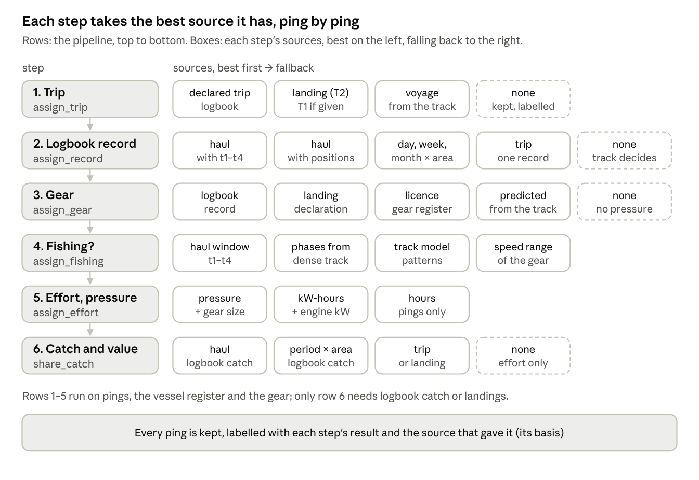

*Markdown export of the claude.ai doc of the same name (revision 108, 2026-10-07). The diagrams are PNG snapshots of the doc's drawings.*

*AI use: drafted by Claude (Anthropic) from the ICES VMS and logbook data-call code (commit `a844911`) and the grammar of sea-going data. Human review pending.*

Mapping fishing activity (effort, pressure on the seabed or stock, and catch) is one cascade, applied to every ping:

1. find its trip;
2. find the logbook record that covers it, if any;
3. find its gear;
4. decide whether the vessel was fishing;
5. give fishing pings their effort (hours, kW-hours) and a gear-specific pressure;
6. where a logbook or landings exist, give them a share of catch and value.

**Effort and pressure need pings, the vessel register and the gear; only catch and value need a logbook or landings.** Each step takes the best source it has for each ping and falls back when it is missing, so one flow serves every data resolution. The last section reads the ICES VMS and logbook data call through this flow.

## The grammar, in brief

A set of linked tables, one per level and each child keyed to its parent, holds every vessel-based record at any resolution:

- **Trip** (`declared_trips`): departure to return (times `T1`, `T2`; harbours).
- **Station** (`logbook_records`): one fishing operation, with where and when.
- **Sample** (`logbook_records`): the act itself: gear and event times `t1`–`t4` (deployment starts, deployment ends, retrieval starts, retrieval ends).
- **Observation** (`logbook_catch`): catch by species, as the skipper records it in the logbook.
- **Ping stream** (`pings`; AIS, VMS) and **landings** (`landings`): parallel streams, linked to trips afterwards. Landings are recorded by a buyer or authority, not the skipper.
- **Resolution** on every logbook record: a haul, or a total over a day, week, month or trip; the record says which.
- **Basis** on every derived value: recorded, reconstructed, synthesised, or none when no source has it.

## The flow, step by step

Six steps, in pipeline order. Each takes, ping by ping, the best source it has, falls back when that is missing, and records which source answered.



### 1. Trip (`assign_trip`)

- **Declared trip** (`declared_trips`, recorded): departure and return (`T1`, `T2`) from the logbook. Landings give the landing (`T2`), and in some datasets the departure (`T1`).
- **Voyage from the track** (reconstructed): harbour exit to next harbour entry, from the pings flagged inside `harbours` (`flag_pings`). Where only `T2` is declared, the last harbour exit before it gives `T1`.
- **None**: the ping is kept, labelled as having no trip.

### 2. Logbook record (`assign_record`)

Each ping gets the id of the logbook record whose period and area cover it (`record_id`, from `logbook_records`), and what that record covers (`resolution`). Records come at any resolution, and each says which:

- a haul, with event times (`t1`–`t4`) or with positions;
- a total over a day, week or month, in a rectangle or area;
- a whole trip.

Several records may cover one ping, e.g. overlapping static-gear sets. The ping counts them (`n_records`) and carries the finest; all matches stay in a ping-to-record link. With no record, the later steps rely on the track.

### 3. Gear (`assign_gear`)

Gear, gear class (towed or static), width and quantity, from the best source:

- the logbook record;
- the landing declaration (`landings`);
- the licence (`gear_register`);
- predicted from the track by a model trained on vessels with known gear (`track_model`, synthesised).

With no gear, fishing is read from the track pattern alone and pressure stays empty.

### 4. Fishing? (`assign_fishing`)

- **Haul window** (recorded). Every operation has four events: `t1` deployment starts, `t2` deployment ends, `t3` retrieval starts, `t4` retrieval ends. Towed gear fishes from gear on the bottom (`t2`) to gear off the bottom (`t3`), within the whole operation (`t1`–`t4`); static gear is visited while setting (`t1`–`t2`) and hauling (`t3`–`t4`).
- **Partial times** (derived or synthesised): any subset may be reported, e.g. a trawl haul with only `t1` and `t4`. The window is the reported span, narrowed by typical durations (`gear_rules`), or the whole day when no time is given.
- **Coarser record, or none**: the track decides, within the record's period and area if there is one.

Reading the track (reconstructed):

- simplest: the gear's fishing speed range (`gear_speeds`);
- better: patterns over consecutive pings, such as speed steadiness, turning and how long a state lasts (`track_model`, e.g. hidden Markov models);
- with frequent pings, the operation's phases (deployment, towing or soak, retrieval): `t1`–`t4` reconstructed from the track;
- haul windows from well-recorded vessels train and test these methods.

Pings judged not fishing are labelled, not removed.

### 5. Effort and pressure (`assign_effort`)

Fishing pings only:

- **hours**: the interval to the next ping, long gaps capped;
- **kW-hours**: hours × engine power (`vessel_register`);
- **pressure**, gear-specific: swept area for towed gear (width × speed × time); gear quantity × soak time for static gear, where set and haul can be placed.

No logbook or landings are needed. Without engine power, hours only; without width or quantity, no pressure.

### 6. Catch and value (`share_catch`)

Needs logbook catch (`logbook_catch`) or landings (`landings`). A unit's catch is shared among its fishing pings by effort; value follows the catch.

| Unit | Source | A fishing ping shares when |
| --- | --- | --- |
| haul with times | logbook | it is inside the haul's window |
| haul with positions | logbook | it is on the haul's day, near its track |
| day × rectangle | logbook | date and rectangle agree |
| week or month × area | logbook | it falls in the period and the area |
| trip | logbook or landings | it is in the trip |

- Catch with no fishing ping at its level moves up a level, so the total is kept.
- With neither source, effort and pressure are mapped; catch and value are "none".

## How far down each kind of data gets

Every row runs the same six steps and goes as far as its data allows. Effort and pressure are the same in every row, given pings, the vessel register and the gear. The rows are not separate datasets: one dataset mixes them by vessel, fleet, year or trip, and each ping takes its own path.

| Data available | Trip | Logbook record | Fishing | Catch and value |
| --- | --- | --- | --- | --- |
| Pings and registers only | voyage from the track | — | track | — |
| + landings | landing; `T1` if given, else the track | — | track | over the trip |
| + weekly or monthly logbook | logbook, else track | period × area | track, within the period | per period × area |
| + daily logbook | logbook | day × rectangle | track, within the day | per day × rectangle |
| + hauls with positions | logbook | haul | track, near the haul | per haul, approximate |
| + hauls with times | logbook | haul window | haul window; track as a check | per haul |

Ping density varies in the same way, within one dataset:

- dense AIS (seconds to minutes) supports `t1`–`t4` reconstructed from the track;
- sparse VMS (an hour or more) supports only speed or pattern rules, with wider uncertainty in effort, and can miss operations shorter than the ping interval.

## One flow, no lost pings

- One process for every resolution, of logbooks and pings alike: each step takes the finest evidence available for that ping and records which it was, so a dataset that mixes resolutions needs no special handling.
- Pings are labelled, not filtered: each keeps its trip, record, gear, fishing state, effort, catch share, basis and flags.
- Only pings in harbour or physically impossible may be set aside, and even these are better flagged.
- What counts is chosen at aggregation, by label, so every total traces back: pings in equal pings out.

## The flow as code

A sketch, not a package. The steps are those above, in order; each takes the pings plus the tables in its brackets, adds its labels with a basis, and passes every ping on.

```r
pings |>                              # vessel, time, lon, lat, speed (AIS, VMS)
  flag_pings(harbours) |>             # harbour polygons: in-harbour pings; impossible points flagged, not dropped
  assign_trip(declared_trips) |>      # vessel, T1, T2: logbook or landings; landings may lack T1 (optional);
                                      #   missing T1, or whole voyages, from the track, harbour to harbour
  assign_record(logbook_records) |>   # vessel, period, area, gear, resolution (optional):
                                      #   a haul with t1–t4, or a day, week, month or trip
  assign_gear(landings,               # gear declared on the landing (optional)
              gear_register,          # vessel, year, gear, width, quantity: licence (optional)
              track_model) |>         # predicts the gear from the track pattern (optional);
                                      #   the logbook record's gear comes first
  assign_fishing(gear_rules,          # haul window per gear class, typical durations
                 gear_speeds,         # fishing speed range per gear class
                 track_model) |>      # pattern or phase model, trained on recorded windows (optional)
  assign_effort(vessel_register) |>   # vessel, year, kW, length
  share_catch(logbook_catch,          # logbook record, species, kg: the skipper (optional)
              landings)               # trip, species, kg, value: buyer or authority (optional)
```

**Inside each step.** The steps are passed tables, but what they use are the variables inside them: each variable is taken, ping by ping, from the best table that has it (`>` reads "else").

```r
flag_pings(pings, harbours)
  # needs:   vessel, time, lon, lat, speed
  # rule:    harbour = inside a harbour polygon; impossible = a position or jump no vessel can make
  # adds:    harbour_id, impossible

assign_trip(pings, declared_trips)
  # needs:   departure (T1), arrival (T2)
  # sources: logbook > landings (T2, sometimes T1) > track: harbour exit to next harbour entry
  # rule:    same vessel, T1 <= time <= T2
  # adds:    trip_id, trip_basis

assign_record(pings, logbook_records)
  # needs:   record_id, period_start, period_end, area, resolution
  # sources: logbook records, at any resolution
  # rule:    same vessel, time in the period, position in the area; the finest record leads
  # adds:    record_id, resolution, n_records

assign_gear(pings, landings, gear_register, track_model)
  # needs:   gear, gear_class, width, quantity
  # sources: logbook record > landing > licence > predicted from the track
  # adds:    gear, gear_class, width, quantity, gear_basis

assign_fishing(pings, gear_rules, gear_speeds, track_model)
  # needs:   gear_class; t1-t4, or track features, or a speed range
  # sources: haul window > phases from a dense track > track_model > gear_speeds
  # adds:    fishing, phase, fishing_basis

assign_effort(pings, vessel_register)
  # needs:   interval, kw, width or quantity
  # rule:    fishing pings only; hours = interval to the next ping, long gaps capped;
  #          kw_hours = hours x kw; pressure = swept area (towed) or quantity x soak (static)
  # adds:    hours, kw_hours, pressure, pressure_unit, effort_basis

share_catch(pings, logbook_catch, landings)
  # needs:   kg, value, and the record or trip they belong to
  # sources: logbook catch (haul > period > trip) > landings (trip)
  # rule:    ping share = unit kg and value x ping hours / unit fishing hours;
  #          catch with no fishing ping moves up one level, so totals are kept
  # adds:    kg, value, catch_basis

# result: one row per ping, every column present, each with its basis
```

What the added variables mean:

| Variable | Meaning |
| --- | --- |
| `harbour_id` | the harbour the ping lies in; empty at sea |
| `impossible` | true for a position or jump no vessel can make |
| `trip_id` | the trip the ping belongs to, declared or rebuilt from the track |
| `record_id` | id of the finest logbook record covering the ping |
| `resolution` | what that record covers: haul, day, week, month or trip |
| `n_records` | how many logbook records cover the ping; above 1 means overlap |
| `gear`, `gear_class` | the gear code; towed or static |
| `width`, `quantity` | gear width (towed); number of hooks, nets or pots (static) |
| `fishing` | true if the ping is judged fishing |
| `phase` | deployment, towing, soak or retrieval, where the record or track can tell |
| `hours`, `kw_hours` | fishing time the ping stands for; the same times engine power |
| `pressure`, `pressure_unit` | gear-specific pressure and its unit, e.g. km² swept or hook-hours |
| `kg`, `value` | the ping's share of the catch and of its value |
| `*_basis` | where each value came from: recorded, reconstructed, synthesised or none |

A step halts per ping, not per run. Where no source supplies a variable, the ping gets `NA` with basis "none", and the flow goes on:

```r
share_catch <- function(pings, logbook_catch = NULL, landings = NULL) {
  units <- catch_units(logbook_catch, landings)   # finest unit with catch per fishing ping; empty if no source
  pings |>
    left_join(units, by = "ping") |>              # pings with no unit get NA, not an error
    mutate(kg          = unit_kg * hours / unit_hours,
           value       = unit_value * hours / unit_hours,
           catch_basis = if_else(is.na(unit_kg), "none", unit_basis))
}
```

- With pings and the vessel register only, the run ends with voyages and fishing from the track, and with hours and kW-hours. Every ping has every column, and the missing ones say "none".
- A step that needs an earlier label skips pings without it in the same way: no trip, no catch share.
- A mixed dataset runs through the same code; its pings just carry different bases.

## The ICES data call, seen through this flow

The ICES VMS and logbook data call runs the same six steps, but along one fixed path built for one resolution: daily logbook records with VMS pings. It has no fallback, and keeps only what reaches its two tables.

**Its inputs.** The logbook file (EFLALO) packs vessel, trip, log event and catch into one row; the VMS file (TACSAT) is the ping stream.


Pings attach to the trip by time and to the log event by date, then receive the catch. Read through the grammar, the file shows three things:

- **Repetition is the format.** Vessel and trip details repeat on every row; the layers must be rebuilt before use.
- **The catch columns are landings, not catch.** Usually sales-note landings allocated down to log events, with nothing in the file saying so.
- **A log event has no stated resolution.** A row can be a haul, a day in a rectangle or a whole trip, and the file does not say which.


| Step | What the data call does | What it cannot do |
| --- | --- | --- |
| 1. Trip | brackets each ping by the logbook trip's departure and landing | rebuild trips from the track; keep pings outside a logbook trip |
| 2. Logbook record | takes the log event whose catch date is the ping's date | use haul times or positions; handle weekly or monthly records; say what resolution a record has |
| 3. Gear | takes the gear of that log event, or the trip's main gear | take gear from landings, licences or the track |
| 4. Fishing? | judges each ping by its own speed: the peaks of each gear's speed distribution, or a set range | use haul windows; read track patterns or phases; resolve operations shorter than the ping interval |
| 5. Effort and pressure | interval since the previous ping, kW-hours, swept area from a gear-width model, per 0.05° c-square | give effort without a logbook; give a pressure metric for static gear |
| 6. Catch and value | shares logbook catch and value by effort: day × rectangle, then trip, then vessel and year | share below day level; place the catch of a multi-day trip reported as one record |

Across the flow:

- **One resolution.** Haul-level logbooks are used at daily level; trip-level records run, but the date on the record decides where the catch goes; pings alone give nothing.
- **Filtering, not labelling.** Pings that are not fishing, and records that fail a check, leave no trace, so outputs cannot be traced back to inputs.
- **No basis.** Nothing records whether a value was recorded, reconstructed or synthesised.

## Sources

- [ices-eg/ICES-VMS-and-Logbook-Data-Call](https://github.com/ices-eg/ICES-VMS-and-Logbook-Data-Call), commit `a844911` (2026-10-05).
- [vmstools 0.77](https://github.com/nielshintzen/vmstools/releases/tag/0.77): trip matching, activity from speed, catch dispatch.
- *A grammar of sea-going observational data* (working document): trip, station, sample, observation; parallel streams; basis.
